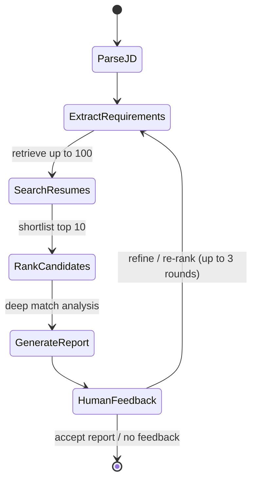

# Agent state machine

The graph stores conversation history, extracted requirements, retrieved candidates,
the ranked shortlist, and per-candidate evidence in its state. Its first screen retrieves
resumes by relevance; detailed scoring and hire/no-hire recommendations then operate on
the top ten. The CLI collects optional human refinements and feeds them back through the
graph for another ranking pass.
